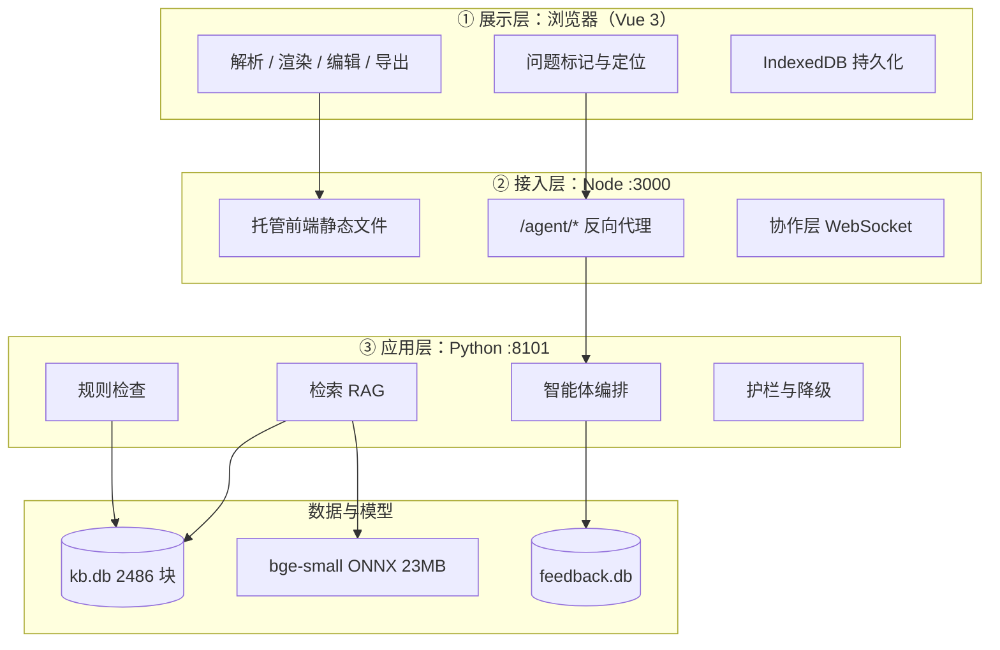
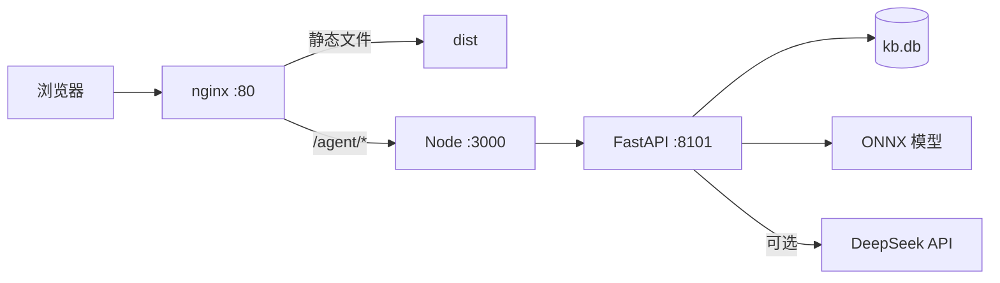
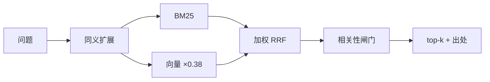
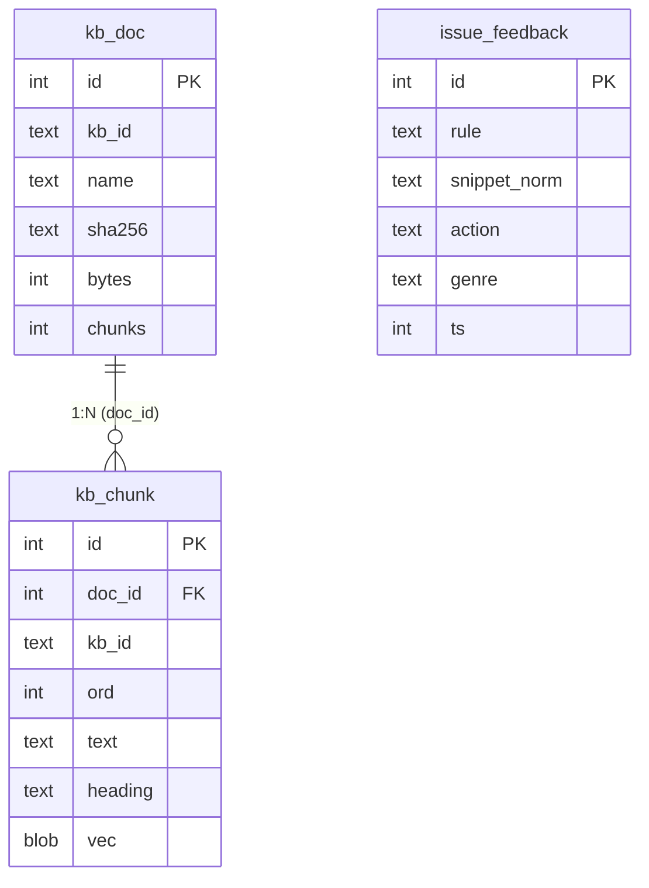

---

# LiteOffice 轻办公 · 项目汇报

> 浏览器内打开、编辑、检查并改写 Office 文档
>
> **文件不上传 · 断网可用 · 规则离线可复现**
>
> 吴彦组｜5 人小组｜汇报 8 分钟 + 演示 2 分钟

<!--
【0:00–0:08】开场 8 秒：LiteOffice，浏览器里打开、编辑、检查并改写 Office 文档。一句话定位：文件不上传、断网可用。
-->

---

# 汇报结构

| 部分 | 内容 | 时长 |
| --- | --- | --- |
| 一 | 产品设计（使命 / 用户 / 获客 / 差异化 / 产品定义） | 3 分钟 |
| 二 | 产品设计应用的原则 | 1 分钟 |
| 三 | 产品实现（选型 / 仓库 / 架构 / **智能体设计** / 数据库 / 接口 / 质量 / 统计） | 4 分钟 |
| 四 | 作品演示 | 2 分钟 |
| 五 | 评委问答 | 5 分钟 |

技术路线一句话：文档处理留在浏览器，AI 收在服务端并套上护栏。

<!--
【0:08–0:13】5 秒：今天只讲三件事——给谁做、怎么做、智能体怎么设计。演示放在开头，已经看过了。
-->

---

# 先看 30 秒：这个项目现在就能用

**① 拖入一份有瑕疵的记叙文**

预览 1 秒出内容。**现在把网线拔掉**，编辑器照常工作 —— 「不上传」不是承诺，是当场可以验证的事实。

**② 点「检查」，连点三条「一键修改」**

0.02 秒列出问题，定位只闪错的那几个字；连点三条，卡片逐条消失，正文随之修正，Ctrl+Z 可撤销。

为什么要先看这个：这两个动作分别证明了「零上传」和「规则可复现」，后面所有设计都是围绕它们展开的。

<!--
【0:13–0:33｜20 秒】现场演示钩子

动作：提前开好本机页面（或公网 /agent 页），拖入 01.docx，点检查，连点三条一键修改。若网络不稳，只做「断网 + 检查」两步。

口播：先不讲架构，给老师看两个动作——断网还能改，说明文件没出机器；0.02 秒出结果、点一条改一条，说明检查是算出来的，不是猜出来的。后面 7 分钟我讲这两件事怎么做到。
-->

<!--
【0:13–0:33】见本页备注，做两个动作即可，不要展开讲技术。
-->

---

layout: section

---

# 一、产品设计

---

# 1.1 使命、口号与策略

## 使命

降低 Office 文档的处理门槛，让需要处理文档的人**不必安装庞大软件、也不必把文件传到别人服务器**，就能打开、修改并保存文档。

## 口号

**打开即用，文件不出门。**

## 整体策略

以「本地安全 + 多格式统一入口 + 明确的能力边界」为主线：先用隐私与速度吸引用户打开第一个文件，再用一致的编辑/阅读体验留住用户，最后用本地 AI 解决「写得不够规范」。

我们不做全能办公套件，只做「处理一份具体文档时最快、最安心的那个网页」。

<!--
【0:33–0:51】18 秒：使命一句话；口号六个字——打开即用、文件不出门；策略是先用隐私和速度吸引，再用一致的编辑体验留住。
-->

---

# 1.1.3 目标用户

| 用户群体 | 典型场景 | 核心顾虑 | 商业角色 |
| --- | --- | --- | --- |
| 大学生、研究生 | 改论文、读 PDF 讲义、整小组作业 | 不愿把未发表作业传到第三方 | 拉规模、做口碑 |
| 教师、教务人员 | 查通知、批名单、提 PDF 文本 | 文件多、格式杂，装软件成本高 | 拉新 + 场景验证 |
| 行政、财务、法务 | 合同、报表、内部清单 | 资料敏感，禁止外传 | **付费主力（合规刚需）** |
| 小团队 | 局域网内多人编辑 | 需要协作，不愿引入云与账号 | 团队版客户 |
| 重视隐私的用户 | 公共电脑、受限网络 | 担心云端留存与统计脚本 | 长尾口碑 |

C 端解决「愿不愿意用」，B 端解决「愿不愿意付」。

<!--
【0:51–1:09】18 秒：不逐行念表，只说三句——C 端（学生教师）拉规模，B 端（律所财务人事）为合规付费，小团队要协作但不愿上云。
-->

---

# 1.1.4 如何获得用户

1. **隐私价值传播**：围绕「不上传文件打开 Word / Excel / PDF」做教程与演示，把「0 次上传」做成可实测的记忆点
2. **零安装入口**：纯静态网页，一个网址打开即用，机房与 Chromebook 可用，无需注册
3. **校园与小组口碑**：从课程作业、社团资料、小组协作切入
4. **分模式体验**：默认预览 1 秒出内容，需要修改才加载编辑内核
5. **AI 增值传播**：11 类文体知识库、语病与乱码检查、改写护栏，解决「写得不规范」
6. **信任型渠道**：开源代码 + 功能边界说明 + 导出自检，让敏感行业用户愿意推荐给同事
7. **变现分层**：个人免费 → 团队版（按席位）→ 私有部署（项目制）

<!--
【1:09–1:24】15 秒：一句话——顺着隐私敏感度切入（合同、工资表、成绩单），用零安装降低试用门槛，用可断网验证建立信任，靠只读分享链接自传播。
-->

---

# 1.1.5 团队优势 · 1.1.6 差异化

**团队优势**

- 小团队决策链短，从想法到可演示只用了 5 周
- 两条技术路线都做过原型，选型有数据而非感觉
- 已定位开源内核的四项未文档化问题（挂载签名、容器高度链、光标坐标、保存接口）并全部解决

**差异化对比**

| 对比维度 | 桌面 Office / WPS | 在线文档 | 只读预览库 | 我们 |
| --- | --- | --- | --- | --- |
| 上手门槛 | 高，需安装激活 | 低，但需登录 | 低，只能看 | 低，拖进来即用 |
| 能否编辑 | 能 | 能 | 不能 | 能 |
| 文件是否上传 | 不上传 | **必须上传** | 不上传 | 不上传（无后端） |
| 断网可用 | 可用 | 不可用 | 可用 | 可用 |
| 体量 | 数 GB | 不占本地 | 数 MB | 199 MB，仅编辑时加载 |

护城河：竞品跟进「不上传」要重写架构（去掉服务端存储），而可断网验证的信任一旦建立，替换成本很高。

<!--
【1:24–1:51】27 秒：团队优势 + 差异化表只讲最后一行——竞品跟进「不上传」要重写架构。这一页是回答「你们凭什么做」，讲慢一点。
-->

---

# 1.2 产品定义

**对于** 只想改几个字、看一眼文档的学生、教师与行政人员，以及处理含隐私文档的低频用户，

**他们** 要临时打开并修改 Office 文档，但不能接受把文件上传到第三方服务器，也不想为此装几个 G 的软件，

**我们的产品** 是一个 **运行在浏览器中的轻量 Office 工具（Web 应用）**，

**它能够** 在不安装、不上传的前提下打开、预览、编辑并保存 docx / xlsx / pptx，查看场景 1 秒内出内容，并提供检查、一键修改、改写与续写，

**不同于** 桌面 Office / WPS（需安装）、在线文档（必须上传）、只读预览库（不能编辑），

**我们的产品** 把预览与编辑拆成两种模式按需加载，用无后端架构让「文件不上传」成为**可实测验证的事实**。

<!--
【1:51–2:11】20 秒：按模板念最后两行即可（是我们的产品是什么、不同于谁），前面几行让老师自己看。
-->

---

# 1.2.1 解决的问题 · 1.2.2 用户故事

**用户故事（业务语言，不含技术细节）**

| 作为（用户） | 我想要（活动） | 以便于（价值） |
| --- | --- | --- |
| 一名任课教师 | 在机房电脑上直接打开学生交的 docx 并写下评语 | 不用先花半小时装 Office，也不用改到一半换机器 |
| 一名行政人员 | 处理含学生信息的表格时，文件始终留在本机 | 不违反学校信息管理规定，也不用写审批单 |
| 一名要交论文的学生 | 快速改掉格式与错别字后导出 | 不用为改几个字装几个 G 的软件 |

**解决的问题与代价**

| 问题 | 现状代价 | 我们的做法 |
| --- | --- | --- |
| 装不了 / 不想装 | 机房、Chromebook、临时电脑都装不了 | 一个网址打开即用 |
| 不敢传 | 合同、工资表、成绩单上传即合规风险 | 主流程不上传，断网可用 |
| 只改几个字 | 为一次修改安装数 GB 软件 | 预览 1 秒出内容，编辑按需加载 |
| 改完不知道错在哪 | 错别字、的地得、时间矛盾全靠自己看 | 规则检查 + 精确定位 + 一键修改 |

<!--
【2:11–2:29】18 秒：只讲三个用户故事里的行政人员那条——「文件始终留在本机」是合规诉求，不是便利诉求。
-->

---

layout: section

---

# 二、产品设计应用的原则

---

# 2. 产品设计原则（四组）

🅿️ 附录 · 8 分钟内不展开，问答时翻这页

| 原则组 | 原则 | 在本产品里的体现 |
| --- | --- | --- |
| 需求 / 信息 / 创新 | 需求 | 只做「改几个字、看一眼」的最小闭环，不做全能办公 |
| | 信息 | 首屏写清 199 MB 首访成本与字体限制，不隐藏代价 |
| | 创新 | 无后端架构，让「不上传」成为可现场拔网线验证的事实 |
| 系统 / 收敛 / 优化 | 系统 | 解析 → 渲染 → 编辑 → 导出是一条链，AI 是外挂增强层 |
| | 收敛 | 只支持 5 种格式，把 3 种编辑格式做深 |
| | 优化 | 预览 1 秒出内容，编辑内核按需下载 |
| 继承 / 效益 / 时间 | 继承 | 复用 pdf.js、OnlyOffice WASM、SheetJS，不重复造轮子 |
| | 效益 | 单文件知识库 + 23 MB ONNX 模型，2 GB 内存可跑 |
| | 时间 | 5 周交付，按「保预览 → 保编辑 → 砍附加」裁剪 |
| 定量 / 简化 / 审核 | 定量 | 误报 18 → 0；检查 0.02 秒；向量召回逐条比对 |
| | 简化 | 三层架构，不引入向量数据库、消息队列 |
| | 审核 | 护栏 + 回读校验 + 334 条自动化用例 |

<!--
【跳过·20 秒】8 分钟版不展开，只在被问「依据什么做的产品决策」时翻这页，讲需求/收敛/审核三条。
-->

---

layout: section

---

# 三、产品实现

---

# 3.1 用户体验设计考虑的因素

🅿️ 附录 · 内容已并入演示与前端页

**首屏：先给结果，再给能力**

- 拖入文件 → 1 秒内看到内容（预览内核轻）
- 需要编辑时才下载 199 MB 内核，并显示等待时长
- 首屏明确写清体积、字体与格式限制

**编辑：把「改哪一处」说清楚**

- 问题标记精确到字，定位只闪错误处
- 一次只改一处，可 Ctrl+Z 撤销
- 改完不自动重查，避免「越改越多」的错觉

**AI：不打扰，但要可解释**

- AI 面板折叠在右侧，用时才展开
- 每个结论都带原因与出处
- 无依据时明确说「没有找到」，不编造

**失败：给退路**

- 写入失败回滚，并说明原因
- 一键改写被护栏拦下时退回规则版
- 无 Key / 断网时功能降级但可用

<!--
【跳过】内容并入后面演示与前端页，不单独讲。
-->

---

# 3.2 技术选型与版本

🅿️ 附录 · 版本清单见 README

| 条目 | 选型 | 版本 | 选型原因 |
| --- | --- | --- | --- |
| 语言 | TypeScript / Python / JavaScript | TS 5.9 / Py 3.11 | 前端强类型防接口漂移 |
| IDE | Visual Studio Code | 1.9x | 前后端统一，插件齐全 |
| 前端框架 | Vue 3 + Vite | 3.5.44 / 8.3.5 | 组件化、构建快，vue-tsc 做门禁 |
| 状态路由 | Pinia / vue-router | 4.1.0 / 5.4.0 | 轻量够用 |
| 样式 | Tailwind CSS | 3.4.19 | 快速统一视觉 |
| 文档解析 | JSZip + 自写 OOXML / SheetJS / pdf.js | xlsx 0.18.5 / pdfjs 4.10 | 浏览器内解析，不经服务端 |
| 编辑内核 | OnlyOffice WASM（onlyoffice-web-local） | 锁定版本 | 浏览器内改 docx/xlsx/pptx |
| 后端 | FastAPI + uvicorn | 0.162.0 / 0.54.0 | 同步接口 + 类型校验 |
| 智能体 | 手写 ReAct（LangGraph 图结构） | langgraph ≥0.2 | 5 步上限，3 个节点，可控 |
| 数据与模型 | SQLite + bge-small ONNX int8 | onnxruntime 1.32 | 单文件免运维，不装 torch |
| 测试 | 自测脚本 + vitest | vitest 5.1.1 | 后端 334 / 前端 46 |

完整版本清单见仓库 README.md 与 package.json / requirements.txt。

<!--
【2:29–2:41】12 秒：只说一句——Vue 3 + FastAPI + SQLite + ONNX，版本号都在 README 和 package.json 里，现场可查。
-->

---

# 3.3 代码仓库与提交统计

**仓库**：`github.com/tc587702-bit/liteoffice-practice`　**主分支**：`feat/vue-rewrite`　**提交**：50　**跟踪文件**：227

| 成员 | 提交数 | 主要职责 |
| --- | --- | --- |
| z233-shiki | 26 | 前端编辑器、文档解析与渲染 |
| agent（AI 协作） | 8 | 检查体系、检索、智能体、护栏 |
| ef-tcl | 8 | 部署套件、systemd、联调发布 |
| tc587702-bit | 4 | 产品定义、文档与验收 |
| Myy-Blade / efttcl | 4 | 测试与素材 |

现场展示三张图：① 仓库 `/pulse` 每人提交曲线　② Projects 看板　③ Issues 缺陷列表

<!--
【2:41–2:51】10 秒：50 个提交、227 个文件、5 人协作，AI 协作提交单独列一行、不混进成员。
-->

---

# 3.4 全生命周期的主要问题与解决

| 阶段 | 问题 | 发生原因 | 解决办法 |
| --- | --- | --- | --- |
| 分析 | 目标用户说不清，一度想服务「所有办公人群」 | 只按规模想，没做访谈 | 收敛到学生/教师/行政 + 隐私敏感低频用户 |
| 设计 | 技术路线反复（零构建 vs 现成内核） | 两条路线各有优势，缺数据 | 各做原型，按首访体积与可测性选型 |
| 开发 | 编辑内核光标偏移一行，无法输入 | 内核挂载签名未公开 | 对照官方 demo，修正容器高度与坐标换算 |
| 开发 | 一键修改改错位置、改完仍报 | 多处相同文本，按第一次出现替换 | 改为按字符偏移定位，多处无位置就拒绝 |
| 测试 | 规则误报过多（18 条） | 规则按直觉写，未跑真实语料 | 10 份人工标注回归，误报降到 0，逐条变用例 |
| 部署 | 服务器 API 全部返回 HTML | nginx 只配 SPA 兜底，未反代后端 | 加 `/agent` 反代，前端按同源构建 |

<!--
【2:51–3:11】20 秒：只讲一条最典型的——一键修改曾经改错位置（段里有多个「的」），后来改成按字符偏移定位，多处出现就拒绝。这条最能体现工程能力。
-->

---

# 3.5.1 系统架构（三层）

为什么这样分：文档留在浏览器才可能「不上传」；AI 收在 Python 一侧，Key 不进浏览器，护栏与评测都在服务端。

<!--
【3:11–3:41】30 秒：从下往上讲数据层→应用层→接入层→展示层，落一句结论：文档留在浏览器才可能不上传，AI 收在服务端才能套护栏。
-->

---

# 3.5.2 部署与基础设施

| 项 | 配置 |
| --- | --- |
| 服务器 | 2 核 4 GB 云主机，无 GPU；不装 torch 约 2 GB 内存可跑 |
| 进程 | systemd：`liteoffice-backend`、`liteoffice-agent`（Restart=always） |
| 密钥 | `/etc/liteoffice/agent.env`（chmod 600），只在服务端 |
| 数据 | kb.db 10.3 MB + ONNX 23 MB 随仓库分发，克隆即可检索 |

已知缺口：接口鉴权与 CORS 白名单未做，公网部署前必须补 token 校验。

<!--
【3:41–3:56】15 秒：一台 2 核 4G 云主机，nginx → Node → FastAPI，Key 只在 systemd 环境文件里。然后主动说：鉴权还没做，上线前要补——诚实反而加分。
-->

---

layout: section

---

# 智能体技术设计

任务编排 · 工具调用 · 记忆 · 护栏 · 专业知识库

<!--
【3:56–4:00】4 秒：这是今天的重头，分六页看：编排、工具、记忆、护栏、知识库、以及它们怎么协作。
-->

---

# 智能体①：任务编排（5 步以内的 ReAct）

| 设计点 | 做法 | 为什么 |
| --- | --- | --- |
| 循环上限 | `MAX_STEPS=5`，达到即强制进入 final | 防死循环；必有回应 |
| 意图先验 | 字符 n-gram 朴素贝叶斯给 6 类意图打分，置信度 ≥0.35 直接定工具 | 省一次模型调用（3–8 秒） |
| 参数兜底 | 模型漏参数时按工具名从原问题抽取 | 不让工具空跑 |
| 超限收尾 | 用已有观察组织答案，不再调工具 | 保证一定给出回应 |
| 多轮指代 | `resolve_reference(query, prev)` 补回上一轮对象 | 「那它怎么改」能听懂 |

<!--
【4:00–4:28】28 秒：ReAct 四步 + 5 步上限；意图先验省一次模型调用。一句话总结：它决定「先做什么」，也负责在异常时收尾。
-->

---

# 智能体②：工具调用（14 个工具，文本 JSON）

| 类别 | 工具 | 约束 |
| --- | --- | --- |
| 统计 | `get_stats` `doc_brief` | 只读 |
| 结构 | `get_outline` `doc_outline` `doc_section` | 缺结构时不许调 |
| 检索 | `search_document` `doc_search` `kb_search` | 最多 2 次，第二次换关键词 |
| 检查 | `check_tables` `check_headings` `check_duplicates` `doc_improve` `diagnose_report` | 确定性结果 |
| 取数 | `doc_tables` | 无表格不许调 |

**为什么不用 function calling**

- 模型只输出**文本 JSON**：`{"thought":"…","action":"工具名","action_input":{…}}`
- 任意模型都能跑；每步 action 与结果都进 `steps[]`，可回放可解释
- 坏输出有三层解析兜住：标准 JSON → 配平括号 → 截断修复

**确定性拦截**

用户要求「往正文加代码」时直接拒绝并给替代方案——文体不符，且正确性无法验证。

<!--
【4:28–4:50】22 秒：14 个工具分五类；用文本 JSON 而不是 function calling 的两个理由——换模型零改动、每步可记录；参数白名单与三层解析兜住坏输出。
-->

---

# 智能体③：记忆（三层，都不参与生成）

| 层 | 存放 | 内容 | 作用 |
| --- | --- | --- | --- |
| 会话记忆 | `_SESSIONS`（上限 200，LRU 淘汰） | 上一轮问题与引用 | 指代消解、追问 |
| 偏好记忆 | `feedback.db` → `issue_feedback` | `(rule, 片段指纹, dismiss/accept, genre)` | 「不用改」下次不再报，并按规则降权 |
| 工作区记忆 | 浏览器 IndexedDB | 文档、草稿、会话列表 | 关掉页面再打开仍在 |

**边界**：记忆只影响「提不提示、是否降权」，不参与生成、不改写正文。

**实测**：同一处标 3 次「不用改」后，下次检查自动跳过，并在报告顶部提示「已跳过 N 条」，可一键恢复。

<!--
【4:50–5:12】22 秒：三层记忆各管一段，关键是边界——记忆只影响「提不提示」，不参与生成、不改正文。这一句一定要说，老师最关心它会不会污染判断。
-->

---

# 智能体④：护栏（三套口径，服务端确定性判定）

| 模式 | 目的 | 守什么 |
| --- | --- | --- |
| `normalize` 规范修正 | 别写错 | 一个字都不许多；幅度 ≤20%；数字/日期/引号不得变动 |
| `polish` 更优美 | 写得更好 | 允许加意象；数字、人名、地名、引号不得改；不得新增事件与人物 |
| `correct` 按事实改 | 改常识错误 | 只改这一句；不得变成另一段；必须真的改了 |

**三条原则**

1. 判定用代码，不看模型自觉
2. 放在服务端，前端绕不过去
3. 拦下要给具体原因（「数字被改动：四点半」）

**拦下之后**：先保守重试一次（只换词、调语序）→ 仍不通过则退回规则版，并如实说明原因。

实测案例：模型把「昨天下完雨后」改成「昨天雨后」并擅自加了「车轮一打滑」，被 polish 护栏拦下。

<!--
【5:12–5:40】28 秒：三套口径 + 三条原则（代码判定、服务端、给具体原因）。举实测例子：模型把「昨天下完雨后」改成「昨天雨后」还加了「车轮一打滑」，被护栏拦下。这是全场最有说服力的细节。
-->

---

# 智能体⑤：专业知识库与 RAG

**知识库**

- `kb.db` 单文件 10.3 MB：77 份文档、2486 个块
- 结构：文体（11 个库）→ 文档 → 块（带标题层级）
- 每块 512 维向量（float32 BLOB），随仓库分发

**RAG 检索**

- 融合用**加权 RRF**（BM25 1.0 / 向量 0.2）：两路分数尺度不可比，RRF 只看排名
- 闸门按查询形态分流：短概念词允许纯语义；长查询必须字面沾边，否则拒答
- 实测：火星探测器 0.431 高于 细节描写 0.417 —— 单一阈值必然误判，所以按形态分流

<!--
【5:40–6:14】34 秒：知识库 77 份 / 2486 块；两路召回 + 加权 RRF + 相关性闸门。给实测对照：同一查询纯 BM25 命中 0 条，混合检索返回 3 条引用——向量确实在起作用。
-->

---

# 智能体⑥：RAG、知识图谱与记忆如何协作

**一次改写的八个动作**

| 组件 | 只负责 | 不负责 |
| --- | --- | --- |
| RAG | 找到该参考的规范，给出出处 | 决定文风与措辞 |
| 关系层（文体 / 术语 / 标题） | 收窄检索范围、统一用词 | 多跳推理 |
| 记忆 | 影响提不提示、是否降权 | 参与生成、改正文 |

**关于知识图谱**：尚未实现实体—关系—实体与多跳查询。现有的是「文体分层 + 术语同义网络 + 标题树」，承担「收窄范围、统一用词」；图结构列为后续工作（从 2486 块中抽机构/政策/指标/时间四类实体建边）。

<!--
【6:14–6:42】28 秒：八个动作串起来讲一遍；然后主动说知识图谱没做，现有的是文体分层 + 同义网络 + 标题树，后续才抽实体建边。主动承认比被问出来好。
-->

---

# 3.5.3 模型选择与对比

| 用途 | 候选 | 实测结论 | 选择 |
| --- | --- | --- | --- |
| 生成 / 判断 | deepseek-chat（云端） | 中文公文与语病判断稳定 | ✅ 默认 |
| 生成 / 判断 | deepseek-flash（推理型） | 先思考再作答，正文易被 max_tokens 截断 | ⚠️ 需放大预算 |
| 生成 / 判断 | 本地 qwen2.5-1.5b | 95 秒/段，会把「面积约三十平方米」改得别扭 | ❌ 降级为可选 |
| 句向量 | bge-small-zh-v1.5（torch） | 基线，单次编码约 20 ms | 开发机 |
| 句向量 | 同模型 ONNX int8 | 余弦 0.967、7/7 查询 top-1 一致、约 3 ms、23 MB | ✅ 服务器默认 |
| 句向量 | OpenAI text-embedding | 需外网与费用，文本离开内网 | ❌ 与不上传冲突 |

**参考文献与开源仓库**

- BGE：`github.com/FlagOpen/FlagEmbedding`；arXiv:2309.07597
- ReAct：Yao et al., arXiv:2210.03629
- RRF：Cormack, Clarke, Buettcher, SIGIR 2009
- ONNX Runtime：`github.com/microsoft/onnxruntime`；pdf.js：`github.com/mozilla/pdf.js`

<!--
【6:42–7:00】18 秒：三句话——云端 deepseek 做生成；小模型 1.5B 实测 95 秒且质量差，降级为可选；向量模型换 ONNX 后 23 MB、余弦 0.967、检索结果一致。
-->

---

# 3.5.4 数据库设计（SQLite 单文件）

🅿️ 附录 · 问答时再翻

`issue_feedback` 独立于知识库，按「规则 + 片段指纹」查询，用于「不用改」记忆；向量以 float32 BLOB 直接存在 `kb_chunk.vec`。

<!--
【7:00–7:08】8 秒：三张表，kb_doc 与 kb_chunk 一对多，feedback 独立存偏好。细节在附录。
-->

---

# 3.5.5 接口设计（23 个，节选 8 个）

🅿️ 附录 · 问答时再翻

| 接口 | 功能 | 输入 | 输出 |
| --- | --- | --- | --- |
| `POST /v1/agent/run` | 跑一轮智能体 | html, query, sessionId | answer, steps[], citations |
| `POST /v1/doc/improve` | 文档检查 | html, genre, useModel | issues[]（含 fix / fixFrom） |
| `POST /v1/doc/review` | 深度分析 | html, maxSections | issues[] + 判定 |
| `POST /v1/doc/continue` | 续写 | html, cursor, genre | text, contextUsed |
| `POST /v1/kb/{kb}/qa` | 知识库问答（RAG） | question, topK | answer, citations |
| `POST /v1/kb/{kb}/rewrite` | 改写 / 规范修正 | selection, mode, genre | candidate, evidence, steps |
| `POST /v1/kb/{kb}/search` | 知识库检索 | query, topK | hits[] |
| `POST /v1/doc/feedback` | 记录「不用改」 | rule, snippet, action | ok |

每个接口都有 Pydantic 模型做输入校验；限流 60 次/分钟/IP；错误统一 JSON 返回，不泄露堆栈。

<!--
【7:08–7:16】8 秒：23 个接口，核心是 agent/run 与 doc/improve 两个；输入输出都有 Pydantic 校验。
-->

---

# 3.5.6 前端设计 · 3.6 软件质量

**前端结构**

- `pages/Editor.vue`：工作区（工具栏 / 纸张 / 侧栏）
- `components/editor/`：`SlideView`（PPTX 还原）、`PdfPages`
- `components/ai/`：`AiAssistantPanel`、`DocCheckReport`
- `lib/`：`file`（解析）、`editorEdit`（改写落地）、`issueMarks`（标记）
- Pinia 状态 + IndexedDB 持久化

**质量控制**

| 项目 | 结果 |
| --- | --- |
| 日志 | 访问日志 + `steps[]` 全链路留痕 |
| 异常 | 统一 JSON；模型失败退回规则版 |
| Python | ruff（含 PEP8），0 告警 |
| 类型 | `vue-tsc --noEmit` 门禁，0 错误 |
| 测试 | 后端 334 条 / 前端 46 条，全通过 |
| 一致性 | 30 条「检查报 ⟺ 改写会改」回归 |

待补：复杂度扫描与 Pylint 语义分析尚未纳入流水线（课程要求截图需现场用插件补）。

<!--
【7:16–7:34】18 秒：前端四层结构一句话；质量给数字——334 条后端用例、46 条前端用例、ruff 与 vue-tsc 零告警、30 条一致性回归。
-->

---

# 3.7 代码统计与交付节奏

🅿️ 附录 · 只报一句结论

| 层级 | 文件数 | 行数 | 说明 |
| --- | --- | --- | --- |
| 后端 Python（app/） | 31 | 11,748 | 含 8 个测试文件 1,099 行 |
| 前端 Vue / TS（src/） | 50 | 10,941 | 页面、组件、lib、样式 |
| Node 协作后端 | 8 | 1,326 | 静态托管 + /agent 反代 + Yjs |
| **合计** | **89** | **24,015** | 不含依赖与构建产物 |
| 数据与模型 | —— | —— | kb.db 10.3 MB / ONNX 23 MB |

**交付里程碑（5 周）**

| 阶段 | 产出 |
| --- | --- |
| 需求分析 | 问题定义、功能与非功能规格、用户故事 |
| 方案设计 | 架构图、接口清单、技术选型决策记录 |
| 开发编码 | 打开预览 → 编辑保存 → 检查与改写 |
| 内部测试 | 保存闭环、异常与兼容性、334 条用例 |
| 发布交付 | 部署套件（systemd / 反代 / 环境文件） |
| 反馈迭代 | 按评审意见修正文档与已知问题清单 |

<!--
【7:34–7:42】8 秒：89 个源文件、24,015 行，5 周完成，AI 协作比例如实标注。
-->

---

# 四、作品演示（2 分钟）

**① 打开**

拖入一份有瑕疵的记叙文，预览 1 秒出内容；断网也能继续。

**② 检查**

点「检查」，0.02 秒列出问题，定位只闪错的那几个字。

**③ 一键修改**

连点三条，卡片逐条消失，正文随之修正，可 Ctrl+Z 撤销。

**④ 问一句**

让智能体说这段有什么问题：给定位、给原因、给改法。

兜底：公网不通或模型超时，切「本机运行 + 关闭 AI」，前两步与一键修改全部照常。

<!--
【跳过】开头已经演示过，这里只说一句：刚才的四步就是完整闭环，随时可以再演示一遍。
-->

---

# 谢谢

**一句话总结**：确定的事做扎实（规则离线、护栏确定性、检索可拒答），不确定的事管起来（模型只在护栏内输出，越界就退回）。

**可能被追问的四点**

1. 有知识图谱吗 → 没有，现有的是文体分层 + 同义网络 + 标题树
2. 模型会改坏原文吗 → 三套护栏 + 回读校验，越界退回规则版
3. 没有 Key 能用吗 → 能，规则检查与一键修改全部离线
4. 数据安全吗 → 主流程不上传，AI 可内网部署，关闭后功能完整

代码位置：`app/graph.py`（编排）· `app/tools.py`（工具）· `app/polish_guard.py`（护栏）· `app/embed.py`（检索）· `app/feedback.py`（记忆）· `data/kb.db`（知识库）

<!--
【7:42–7:54】12 秒收尾：确定的事做扎实，不确定的事管起来。然后把四个预设追问先答一遍（30 秒内），主动结束，交给评委提问。
-->
