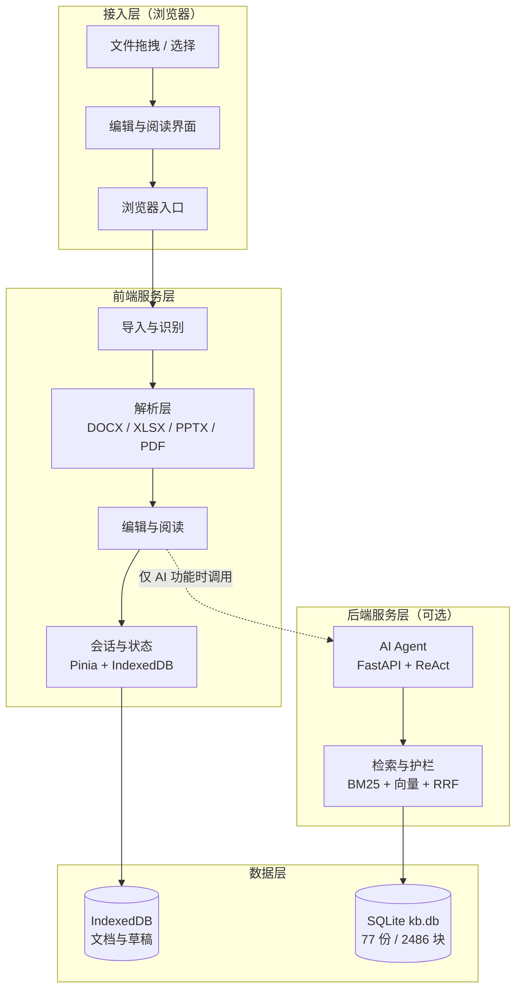

# LiteOffice 产品设计文档

> 产品定位：一个在浏览器本地完成文档解析、编辑与导出的轻量工作台，配套本地 AI 助手。
> 支持格式：DOCX、XLSX、PPTX、Markdown、PDF。
> 核心承诺：文件不上传，解析、编辑、导出都留在用户设备上；AI 只做辅助，不代写。

---

# 目录

1. 产品设计
2. 产品设计应用的原则
3. 产品实现
4. 智能体设计

---

# 1. 产品设计

## 1.1 产品使命、口号和策略

**整体策略**：以“本地安全 + 多格式统一入口 + 明确边界”为主线——用隐私与速度吸引用户，用统一体验留住用户，用本地 AI 辅助写作；不替代桌面套件，只做“处理文档最快、最安心的网页”。

## 1.1.1 使命

让每个人在**不上传文件**下快速打开、修改并导出 Office 文档，并用本地 AI 完成语病检查、文体规范化与知识库问答。

---

## 1.1.2 口号

**主口号：打开即用，文件不出门。**

辅助表达：

- 本地打开、编辑、导出，拖进来就能改。
- AI 只辅助，改写要过四道护栏。

---

## 1.1.3 目标用户

| 用户群体 | 典型场景 | 核心顾虑 |
| --- | --- | --- |
| 学生、研究生 | 改论文、看讲义、小组作业、AI 查语病 | 未发表作业不愿上传第三方 |
| 教师、教务 | 看通知、改名单、提取 PDF 文本 | 格式杂，切换软件成本高 |

---

## 1.1.4 如何获得用户

1. **隐私价值传播**：以“0 次上传打开 Word/Excel/PDF”为卖点，做教程与短视频。
2. **低门槛体验**：纯静态网页、无需注册、秒级预览，需改才加载编辑内核。
3. **校园与小组口碑**：从课程作业、社团资料切入，拖入文件即可体验。
4. **AI 与信任增值**：文体知识库 + 语病检查 + 改写护栏；开源透明、导出自检，让敏感用户敢推荐。

---

## 1.1.5 团队优势

- **算法自主**：DOCX/XLSX 解析与 OOXML 回写自研，不依赖后端与重型 SDK。
- **架构轻量**：前端与 Agent 服务独立运行，通过 HTTP 交互；前端可离线单跑。
- **性能与体验**：Worker 解析、虚拟渲染、懒加载与可取消；拖拽导入、多文件会话、错误兜底形成闭环。
- **诚实可靠**：PPTX/PDF 明确只读；AI 无 Key 时降级离线；类型检查零错误，各项功能均有自检与实测。

---

## 1.1.6 如何做到差异化

| 维度 | 常见方案 | LiteOffice |
| --- | --- | --- |
| 文件流向 | 上传服务器后解析 | 浏览器内解析，文件不出设备；AI 只发选区且二次确认 |
| 格式覆盖 | 单一查看器或重型套件 | 一页统一处理 DOCX/XLSX/PPTX/MD/PDF |
| 编辑与保存 | 只读或导出丢内容 | DOCX/XLSX 编辑回写，导出回读自检，失败即中止 |
| AI 能力 | 整篇代写、不可控 | 只辅助：文体知识库 + 语病检查 + 改写护栏 |
| 体积 | 重 UI 库或桌面套件 | 运行时仅 5 个依赖，主包约 217 KB |

---

# 1.2 产品定义

**产品描述的最简单模板**

对于 **需要本地处理 Word/Excel/PPT/MD/PDF的学生、教师与办公人员**，  
他们 **希望不上传就能查看、修改并导出，又担心隐私、格式乱、大文件卡、写作不规范**，  
产品 **LiteOffice** 是 **本地优先的轻量 Office 文档工作台**，  
它能 **在浏览器内解析、编辑、导出，按需调用本机 AI 做语病检查 / 知识库问答 / 规范改写**，  
不同于 **上传型在线文档、重型桌面套件、单一格式转换器与整篇代写工具**，  
我们 **零上传、零追踪，AI 只辅助，不代写**。

---

## 1.2.1 解决的问题

1. **隐私泄露**：在线工具要求上传，敏感文件离开本机即失控。
2. **格式割裂**：Word、Excel、PDF 各用一套软件，来回搬运。
3. **大文件卡顿**：等待久、页面卡死，甚至被拒绝打开。
4. **导出不可信**：编辑后格式损坏、工作表丢失或内容不一致。
5. **边界模糊**：PPTX/PDF 只读却无提示，误以为改动已保存。
6. **写作不规范**：语病与格式错误难自查，AI 又易整篇代写。

---

## 1.2.2 对客户的价值

> 
> 以下用户故事均使用用户可理解的业务语言描述，不包含技术实现细节。

1. 作为**学生**，我想**拖入 Word 作业直接改**，以便**不上传也能按时交**。
2. 作为**财务人员**，我想**改完表格下载回 Excel**，以便**保留原工作表对账**。
3. 作为**教师**，我想**拖入 PDF 讲义看并导出文字**，以便**备课不用换软件**。
4. 作为**写作者**，我想**选中文字让 AI 查语病、改文体**，以便**更规范又不被整篇重写**。

---

## 1.2.3 解决方案

网站（纯前端单页应用）。

---
canvasWidth: 900
---
# 2. 产品设计应用的原则

1. **本地优先**：解析、编辑、导出全部在本机，不增加上传路径。
2. **创新原则**：相较于其他部分软件，本产品更加轻量，更加便捷，更加简单。
3. **优化效益**：更小的内存使用，更快的打开速度，更方便的应用方式。


---

# 3. 产品实现

---

### 3.1 用户体验设计考虑的因素

| 因素 | 设计考虑 | 在产品中的体现 |
| --- | --- | --- |
| 第一入口 | 只需“把文件放进来” | 首页突出“打开文件”与拖拽区，支持多文件导入 |
| 信任感 | 隐私承诺可感知 | 常驻“本地安全模式”“0 次上传” |
| 格式识别 | 快速确认文件类型 | 统一显示 DOCX/XLSX/PPTX/MD/PDF |
| 反馈及时 | 耗时操作要有反馈 | 展示阶段、耗时与进度，超时可取消 |
| 编辑效率 | 常用操作在手边 | 顶部工具栏：加粗、标题、列表、引用、撤销/重做 |
| 大文件可用 | 不简单拒绝文件 | 分级提示、先出内容后落库、虚拟渲染与懒加载；失败可下载原件 |
| AI 辅助 | 用“说话”代替“找菜单” | 助手面板：问答 / 改写 / 语病检查，引用可跳回原文 |

---

### 3.2 产品所用编程语言及 IDE、平台、框架等

**前端**

| 类别 | 技术/工具 | 版本 | 用途 |
| --- | --- | --- | --- |
| 语言 / 运行时 | TypeScript / Node.js | 5.9 / ≥20.19 | 静态类型 + 本地构建 |
| 框架 / 路由 / 状态 | Vue 3 + vue-router + Pinia | 3.5.44 / 5.4.0 / 4.1.0 | SFC + hash 路由 + 会话状态 |
| 构建 / 样式 | Vite + Tailwind CSS | 8.3.5 / 3.4.19 | 按需加载 + 原子类 |
| 文档解析 | SheetJS + pdf.js + 自研 OOXML | 0.18.5 / 4.10.38 / 0.1.0 | XLSX、PDF、DOCX/MD 读写 |
| 测试 | vue-tsc + Vitest | 3.3.13 / 5.1.1 | 类型检查 + 单元测试 |

---

### 3.2 产品所用编程语言及 IDE、平台、框架等（续）

**AI 服务 · 检索 · 平台**

| 类别 | 技术/工具 | 版本 | 用途 |
| --- | --- | --- | --- |
| AI 服务 | FastAPI + LangGraph + LiteLLM | 0.162.0 / ≥0.2 / ≥1.50 | Agent 编排与模型路由，无 Key 降级离线 |
| 检索 / 嵌入 | onnxruntime + bge-small-zh-v1.5 | ≥1.17 | 512 维本地向量 + BM25，RRF 融合 |
| 平台 | VS Code / 现代浏览器 | 1.90+ / Chrome/Edge 120+ | 纯前端运行，需 Worker、IndexedDB |

**选型说明**：前端 Vue 3 + Pinia 承载会话状态；DOCX/XLSX/MD 用自研 zip/xml 模块，SheetJS、pdf.js 按需加载；AI 用 FastAPI + LangGraph、无 Key 即降级；版本以 `package.json` / `requirements.txt` 为准。

---

### 3.3 代码仓库链接及代码提交历史截图

仓库：`(https://tc587702-bit.github.io/liteoffice-practice/)`


---

### 3.4 全生命周期主要问题与解决方法汇总

覆盖**分析、设计、开发、测试、部署运维**五个阶段。

| 阶段 | 问题 | 原因 | 解决 |
| --- | --- | --- | --- |
| 分析 | 能力边界模糊 | PPTX/PDF 被误认为可编辑 | 明确 DOCX/XLSX 可回写、PPTX/PDF 只读并标注 |
| 设计 | 多格式会话割裂 | 各格式结构不同、无统一模型 | 统一文档会话模型，Pinia 集中管理 |
| 设计 | 大文件阻塞 | 主线程全量渲染 | Worker 解析、分块虚拟渲染、懒加载、可取消 |
| 开发 | XLSX 回写丢表 | 重建工作簿 | 读原 workbook 写回，导出前校验 |
| 测试 | 导出损坏难发现 | 只验证下载触发 | 导出自检，失败即中止 |

---

### 3.5 软件概要设计：架构与模块

**总体架构**：一个仓库、两个可独立运行的服务（前端 + AI Agent），代码互不 import，只通过 HTTP 约定交互；前端可完全离线单跑。

| 模块 | 职责 | 主要实现 |
| --- | --- | --- |
| 导入与识别 | 拖拽/选择文件，识别格式与大小 | 文件卡片、格式标识、可取消进度 |
| 解析层 | DOCX/XLSX/PPTX/MD/PDF 转可展示内容 | 自研 docx/xlsx/markdown/zip/xml + SheetJS + pdf.js |
| 编辑与阅读 | 编辑、虚拟渲染、大纲、字数、阅读模式 | contenteditable + 分块虚拟滚动 + 工具栏 |
| 会话与状态 | 多文件、改动、进度、Toast 与兜底 | Pinia + IndexedDB |
| 导出与自检 | 生成文件并校验，失败兜底 | Blob 下载 + 回读校验 |
| AI Agent | 语病检查、知识库问答、规范改写 | FastAPI + LangGraph ReAct + 检索 + 护栏 |
| 路由与部署 | 页面切换、静态托管 | vue-router hash + Vite |
<style>
table {
  font-size: 0.72em;
}
td {
  line-height: 1.45;
}
</style>
---

#### 3.5.1 系统架构图



<div class="text-sm opacity-70 mt-2">
前端可脱离后端独立使用（打开 / 编辑 / 导出全在浏览器）；只有检查、改写、问答需要后端。
</div>

---

#### 3.5.2 数据存储与数据库设计

| 存储 | 位置 | 内容 | 作用 |
| --- | --- | --- | --- |
| IndexedDB `liteoffice` | 浏览器 | 会话、文档 HTML、表格、PDF 元数据 | 文档正文持久化，支撑「不上传」 |
| SQLite `kb.db` | `code/agent/data` | 知识库 77 份文档 / 2486 块 / 术语表 | RAG 检索语料，随仓库分发 |

**为什么这样分**：文档正文留在浏览器，才谈得上「不上传」；知识库独立成库，克隆仓库即可检索，无需重建。
**E-R**：`kb_doc`（文档）1 — N `kb_chunk`（块，含 512 维向量）；`issue_feedback`（偏好记忆，按规则 + 片段指纹查询）。

---

#### 3.5.3 接口设计

| 服务 | 方法 | 路径 | 作用 |
| --- | --- | --- | --- |
| AI | POST | `/v1/agent/run` | LangGraph 编排 |
| AI | POST | `/v1/chat` | 纯对话，无工具 |
| AI | POST | `/v1/kb/{kb_id}/search` | BM25 检索（问答出口） |
| AI | POST | `/v1/kb/{kb_id}/evidence` | 术语 + 规范片段（改写出口） |
| AI | GET/POST | `/v1/kb/{kb_id}/documents` | 列出 / 入库 |
| AI | GET | `/health` | 健康检查 |

---

#### 3.5.4 前端设计

```
pages（Home / Editor）
   ↓
stores（Pinia：workspace.ts）
   ↓
lib（docx / xlsx / markdown / pdf / exporter / db）
   ↑
components（只消费状态与回调）
```

- 依赖方向单向：`zip/xml` ← `docx/xlsx/markdown` ← `exporter`。
- 运行时仅 5 个依赖，无 UI / 图标 / 动画库。
- Worker 承载 md 与 xlsx；docx 用 DOMParser、pdf 自带 worker。
- 编辑先写 store 再异步落 IndexedDB；>2 MB 先出内容、后台落库。

---

### 3.6 软件质量


---

# 4. 智能体技术设计

> 总原则：**规则做确定的事，模型做理解的事；模型输出先过护栏再进文档。**
> 五个部件：编排 · 工具 · 记忆 · 护栏 · 知识库。
> 代码位置：`code/agent/app/graph.py`（编排）· `tools.py`（工具）· `polish_guard.py`（护栏）· `embed.py`（检索）· `feedback.py`（记忆）· `code/agent/data/kb.db`（知识库）。

---

### LiteOffice 智能体五个组成

| 组成 | 代码位置（文件名） | 实现 |
| --- | --- | --- |
| 任务编排 | `arrange.py` | LangGraph 编排 ReAct 循环（plan → call_tool → respond），步数上限 5；意图先验命中即省一次模型调用 |
| 工具调用 | `tools.py` | 14 个工具：统计 / 结构 / 检索 / 检查 / 取数；文本 JSON 三层解析兜底，工具结果不经模型二次生成 |
| 记忆 | `memory.py` | 会话 / 偏好 / 工作区三层记忆；只影响「提不提示、是否降权」，不参与生成 |
| 护栏 | `polish_guard.py` | normalize / polish / correct / 深度分析四套口径，服务端确定性判定，不过即退回规则版 |
| 专业知识库 | `embeding.py` + `kb.db` | 77 份文档、2486 块；BM25 + 向量两路召回，RRF 融合，全部本地不上传 |

<style>
table { font-size: 0.75em; }
td { line-height: 1.4; }
</style>
---

## 4. 智能体设计：五个部件与请求流转

> **总原则**：规则做确定的事，模型做理解的事；模型输出先过护栏再进文档。

一次请求：① **编排**决定做什么 → ② **工具**取回材料 → ③ **记忆**保持前后一致 → ④ **护栏**守住边界（知识库为③④提供依据）。

| 部件 | 核心实现 |
| --- | --- |
| 任务编排 | 5 步以内 ReAct：`think` 输出 JSON 动作 → `run_tool` 执行 → 观察回填 |
| 工具调用 | 14 个（统计 / 结构 / 检索 / 检查 / 取数），坏 JSON 三层兜底 |
| 记忆 | 会话 / 偏好 / 工作区三层，不参与生成、不改正文 |
| 护栏 | 服务端确定性判定，不过即退回规则版 |
| 知识库 | 77 份文档、2486 块，BM25 ∪ 向量两路召回 |

---

# That's all!
